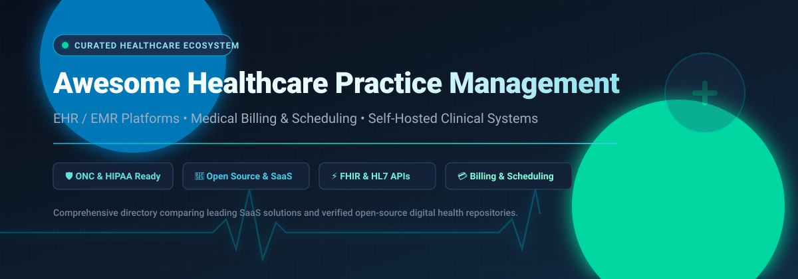
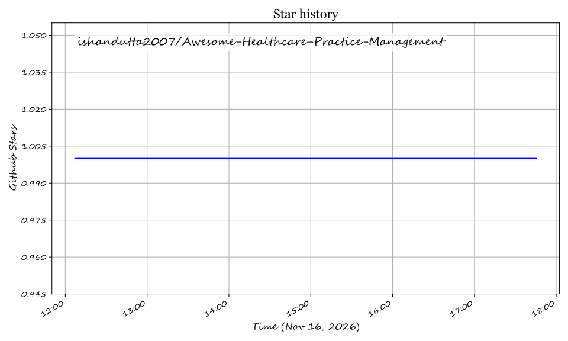

# Awesome-Healthcare-Practice-Management

  

  
  
  
  
  

---

## 🏥 Curated Healthcare Practice Management Ecosystem

> **A comprehensive, SEO-optimized curated directory of leading SaaS platforms and open-source GitHub projects for Healthcare Practice Management, Electronic Health Records (EHR), Electronic Medical Records (EMR), Medical Billing, Patient Portals, and Self-Hosted Clinical Systems.**  
> *Last updated: March 2026*

This directory tracks top-tier **cloud SaaS platforms** and verified **open-source repositories** powering modern clinical workflows—from solo practitioner clinics and multi-specialty ambulatory practices to large hospital information networks and global low-resource NGOs. Whether you require enterprise turnkey revenue cycle management or full data sovereignty with HIPAA/ONC-compliant open-source software, this list compares pricing, free trials, compliance, and developer capabilities.

---

## 📑 Table of Contents
- [📈 Sector Overview & Market Dynamics](#-sector-overview--market-dynamics)
- [☁️ SaaS & Hosted Platforms](#️-saas--hosted-platforms)
- [💻 Open-Source GitHub Projects](#-open-source-github-projects)
- [🤝 How to Contribute](#-how-to-contribute)
- [💖 Support & Sponsorship](#-support--sponsorship)
- [⭐ Star History](#-star-history)
- [⚠️ Disclaimer & Compliance Notes](#️-disclaimer--compliance-notes)

---

## 📈 Sector Overview & Market Dynamics

The global medical practice management software (PMS) market is estimated at approximately **$13.5B–$15B in 2025–2026**, projected to surpass **$18B by the late 2020s** at an estimated 8–10% CAGR. 

The market is **moderately fragmented** rather than a winner-take-all monopoly:
- **Inpatient / Large Hospital Networks:** Highly concentrated among enterprise health-tech incumbents (such as Epic Systems and Oracle Health / Cerner).
- **Ambulatory & Independent Clinics:** Significantly fragmented across cloud-native EHR/PMS suites, specialty-focused platforms (mental health, therapy, dermatology), and regional providers tailored to local compliance and billing rules.

---

## ☁️ SaaS & Hosted Platforms

*Leading proprietary cloud platforms offering integrated EHR, clinical scheduling, patient portals, and revenue cycle management (RCM).*

| Product | Company Size (Valuation / Revenue) | Description | Pricing (Starting) | Free Tier / Trial Limits |
|---|---|---|---|---|
| **[athenahealth](https://www.athenahealth.com/)** | ~$17B valuation (acquired by Bain Capital & H&F); ~$1.7B+ annual revenue | **Cloud-based EHR, practice management, and RCM.** Network utilized by **160,000+ providers**. Strong focus on automated medical billing rules, patient engagement, and population health. | ~$140/provider/month base EHR license or 4%–7% of monthly collections (RCM) | No free forever plan; no self-serve free trial (offers 30–60 min guided live sales demo) |
| **[NextGen Healthcare](https://www.nextgen.com/)** | ~$1.8B valuation (acquired by Thoma Bravo); ~$653M annual revenue | **Enterprise ambulatory EHR and practice management suite.** Tailored for multi-specialty practices, offering integrated clinical workflows, patient portals, and NextGen Ambient Assist AI documentation. | ~$300–$500/provider/month (NextGen Office baseline) | No free forever plan; no self-serve free trial (guided sales demo and consultation upon request) |
| **[AdvancedMD](https://www.advancedmd.com/)** | ~$1.13B valuation (acquired by Francisco Partners); ~$105M EBITDA | **All-in-one cloud practice management and EHR.** Features automated scheduling, clinical charting, telehealth, patient self-scheduling, and comprehensive medical billing workflows. | ~$130–$399/provider/month (Mental Health / AdvancedMD Now) or ~$429+/provider/month (General PM) | 30-day free trial (self-service for AdvancedMD Now / Mental Health, up to 3 providers) or 60-day trial for Patient Engagement bundle |
| **[Kareo (Tebra)](https://www.tebra.com/)** | ~$1B+ valuation (unicorn; raised $250M in 2025); ~$240M–$250M ARR | **Cloud clinical and practice operations engine for independent clinics.** Formed by the merger of Kareo and PatientPop, delivering integrated billing, scheduling, and patient acquisition. | ~$49–$99/provider/month (starter single module) or ~$300+/provider/month (EHR + PM bundle) | No free forever plan; no self-serve free trial (offers customized 1-on-1 product demo) |
| **[DrChrono](https://www.drchrono.com/)** | ~$182.5M valuation (acquired by EverCommerce); powers 13,000+ providers | **Mobile-first EHR and medical practice management.** Notable for iPad/iOS clinical charting, digital check-in kiosks, integrated telemedicine, and medical billing APIs. | ~$199/provider/month (Foundation tier) | No free forever plan; no automated free trial (provides guided live sales product demo) |

---

## 💻 Open-Source GitHub Projects

*Active open-source electronic health records, practice management suites, synthetic data simulators, and FHIR platforms. Sorted in descending order by GitHub stargazers.*

| Project | Stars_Badge | Description |
|---|---|---|
| **[HospitalRun](https://github.com/HospitalRun/hospitalrun-frontend)** |  | **Offline-first EHR and hospital information system designed for low-resource environments.** Built with React/Node.js, HospitalRun works seamlessly when internet access is unstable or offline and synchronizes automatically upon reconnection. Features patient registration, clinical documentation, billing, medication dispensing, and basic reporting. |
| **[OpenEMR](https://github.com/openemr/openemr)** |  | **The flagship open-source EHR and practice management system with ONC certification.** GPLv2 licensed (PHP/MySQL). Certified as an ONC Complete EHR, OpenEMR provides native TOTP 2FA, OAuth2/OpenID Connect SSO, pediatric growth charts, e-prescribing, medical billing, scheduling, and SMART on FHIR REST APIs. Ideal for independent practices seeking full data sovereignty. |
| **[Synthea](https://github.com/synthetichealth/synthea)** |  | **Synthetic patient population simulator for digital health and EHR development.** Written in Java, Synthea models realistic medical histories across entire lifetimes and exports production-grade synthetic records in HL7 FHIR (R4/STU3), C-CDA, and CSV without PHI privacy or HIPAA restrictions. Indispensable for testing practice management systems. |
| **[Medplum](https://github.com/medplum/medplum)** |  | **API-first, headless open-source EHR and clinical development platform.** Built with TypeScript and React, Medplum delivers a full-stack FHIR backend, client SDKs, identity authentication, scheduling primitives, clinical charting components, and automation bots for modern healthcare app developers. |
| **[OpenMRS](https://github.com/openmrs/openmrs-core)** |  | **The world's leading open-source enterprise EMR platform for public health and resource-constrained clinics.** Used across 80+ countries managing 22M+ patient records. Built on Java and MySQL with an extensible concept dictionary, modular architecture, and robust HL7/FHIR interoperability via OpenHIM. |
| **[Open Hospital](https://github.com/informatici/openhospital)** |  | **Free, open-source Hospital Information Management System (HIMS) and electronic medical record application.** Developed in Java and React, Open Hospital manages outpatient/inpatient admissions, patient examinations, pharmaceutical stock, laboratory exams, billing, and statistical reporting in rural and developing clinics. |
| **[Frappe Health](https://github.com/frappe/health)** |  | **Open-source hospital and clinical practice management system built on the Frappe/ERPNext framework.** Features doctor appointment scheduling, patient encounter logging, lab management, inpatient ward admissions, vital sign tracking, and integrated healthcare accounting based on FHIR standards. |
| **[Bahmni](https://github.com/Bahmni/bahmni-core)** |  | **Comprehensive open-source Hospital Management Information System (HMIS) combining OpenMRS, OpenELIS, and Odoo.** Deployed in 500+ clinical sites across 50+ countries. Designed for low-connectivity environments with offline tablet sync (Bahmni Connect), lab workflows, PACS/radiology integrations, and inventory control. |
| **[OSCAR EMR (Open-OSP)](https://github.com/open-osp/open-osp)** |  | **Mature open-source EMR and practice operations platform widely deployed across primary care.** Originating from McMaster University, OSCAR includes comprehensive scheduling, billing rules, patient charts, and native 2FA with strong session security. Maintained by the Open OSP Service Cooperative. |
| **[GNU Health](https://github.com/mbehrle/docker-gnuhealth-demo)** |  | **Libre digital health ecosystem and Hospital Information System.** Core development is hosted at [codeberg.org/gnuhealth/his](https://codeberg.org/gnuhealth/his) on the Tryton framework, with popular community Docker configurations on GitHub. Provides socio-economic tracking, disease surveillance, laboratory management, and clinical management. |

---

## 🤝 How to Contribute

We welcome contributions from clinicians, software developers, and health IT specialists!

1. 🍴 **Fork the repository** to your GitHub account.
2. 🌿 **Create a new branch** (`git checkout -b feature/add-new-practice-tool`).
3. 📝 **Add or update entries in `README.md`**:
   - For SaaS products: Provide specific starting pricing, explicit free trial conditions, and verifiable company size.
   - For Open-Source projects: Include Stars_Badges linked to stargazers and concise technical summaries.
4. 🚀 **Submit a Pull Request** with clear context and official references.

---

## 💖 Support & Sponsorship

If this curated repository saves you time, helps your clinic or startup evaluate software, or assists your digital health research, please consider supporting the project!

- ⭐ **Star this repository** to help others discover it on GitHub.
- 🍴 **Fork & Share** with your engineering and clinical peers.
- ☕ **Sponsor or buy a coffee**: Support ongoing curation and maintenance via the **[GitHub Sponsors Dashboard](https://github.com/sponsors/ishandutta2007)**.

Thank you to all community members and healthcare IT contributors!

---

## ⭐ Star History

---

## ⚠️ Disclaimer & Compliance Notes

- 📋 **Community Curated:** This list is curated for educational and comparison purposes; inclusion does not constitute a formal commercial endorsement.
- 🔒 **HIPAA & PHI Security:** Healthcare practice management platforms process Protected Health Information (PHI) governed by HIPAA, HITECH, GDPR, and regional statutory laws. Organizations must verify encryption at rest (AES-256, database TDE), end-to-end encryption in transit (TLS 1.3), role-based access control (RBAC), Business Associate Agreements (BAAs), and strict immutable audit logging.
- 🚨 **Open-Source Architectural Responsibility:** Many open-source database backends (MySQL, MariaDB, PostgreSQL) store records unencrypted by default. Deployment teams must configure Transparent Data Encryption (TDE), OS-level full-disk encryption (BitLocker/LUKS), and robust backup snapshots before clinical deployment in production.

---

  <b>Built for clinic administrators, health IT architects, and developers shaping the future of digital healthcare.</b>

## ⭐ Star History

<a href="https://star-history.com/#ishandutta2007/Awesome-Healthcare-Practice-Management&Timeline" align="center">
  <picture>
    <source media="(prefers-color-scheme: dark)" srcset="assets/ishandutta2007_Awesome-Healthcare-Practice-Management_growth.svg">
    
  </picture>
</a>
